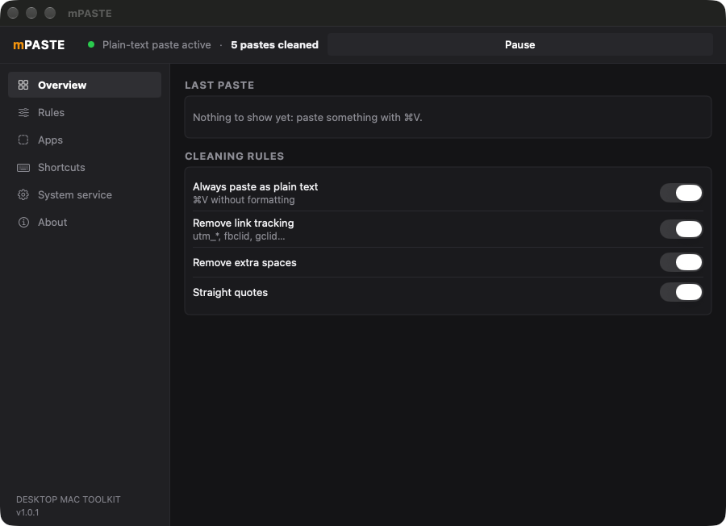

# mPASTE

## About

**mPASTE** is a native macOS menu bar app that makes ⌘V paste as plain text everywhere. It strips formatting, removes tracking parameters from links (utm_*, fbclid, gclid…), trims extra spaces and can straighten quotes, then restores your clipboard so rich formatting is still there when you want it (⌥⌘V). It can be installed as a background agent that starts at login.

- Authors: Starbudweiser & Claude Code (Anthropic) — MIT License, © 2026 Starbudweiser.
- Provided as is, without warranty. Part of the **DESKTOP MAC TOOLKIT**. Inspired by Pure Paste (Sindre Sorhus); no code shared.
- In the app: menu **mPASTE ▸ About mPASTE**.



## Features (1.0)

- **⌘V pastes plain text everywhere** (keyboard event interception, Accessibility permission); the original clipboard, formatting included, is restored right after. **⌥⌘V** pastes with formatting, **⌃⌥P** pauses.
- **Rules**: plain text, link tracking removal, extra spaces, straight quotes.
- **Excluded apps**: Pages, Keynote and Numbers by default, editable list.
- **System service**: background agent (user LaunchAgent, no administrator rights) that can be installed and uninstalled from the app; `mPASTE --service install|uninstall|status` on the command line.
- **Standard Socle interface**, French, English, Spanish, Italian; automatic updates; monochrome menu bar icon.

## Development

```
DEV=1 ./build_app.sh      # mPASTE DEV edition (fr.stephan.mpaste.dev)
./build_app.sh            # local version, installed in Applications Personnelles
mPASTE --selftest         # tests of the cleaning and of the service file
./release.sh 1.0.0        # notarization and GitHub release (on request)
```

See `ARCHITECTURE.md` and `maquettes/`.

## Support / Soutenir

This app is free. If it is useful to you, you can support the project (optional, no reward expected): [GitHub Sponsors](https://github.com/sponsors/starbudweiser).

Cette appli est gratuite. Si elle vous est utile, vous pouvez soutenir le projet (facultatif, sans contrepartie) : [GitHub Sponsors](https://github.com/sponsors/starbudweiser).
